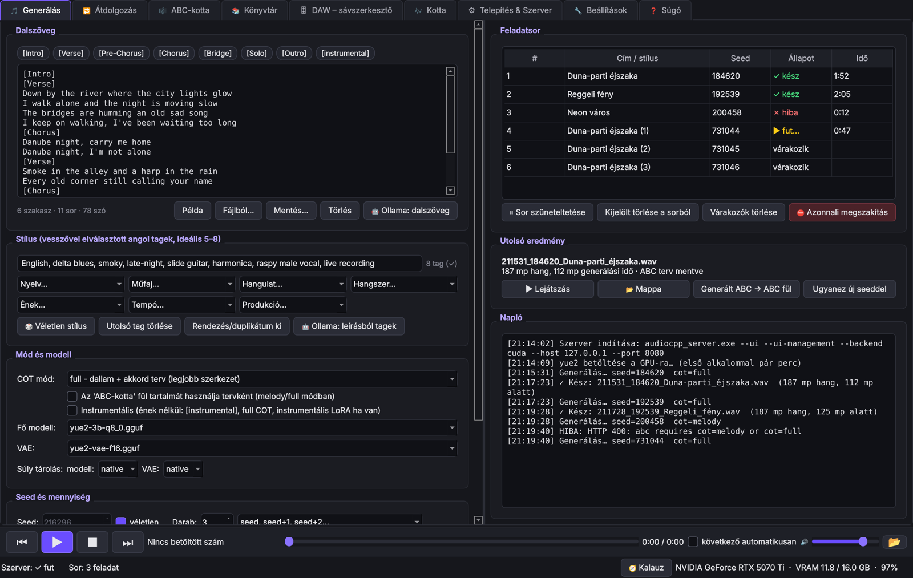
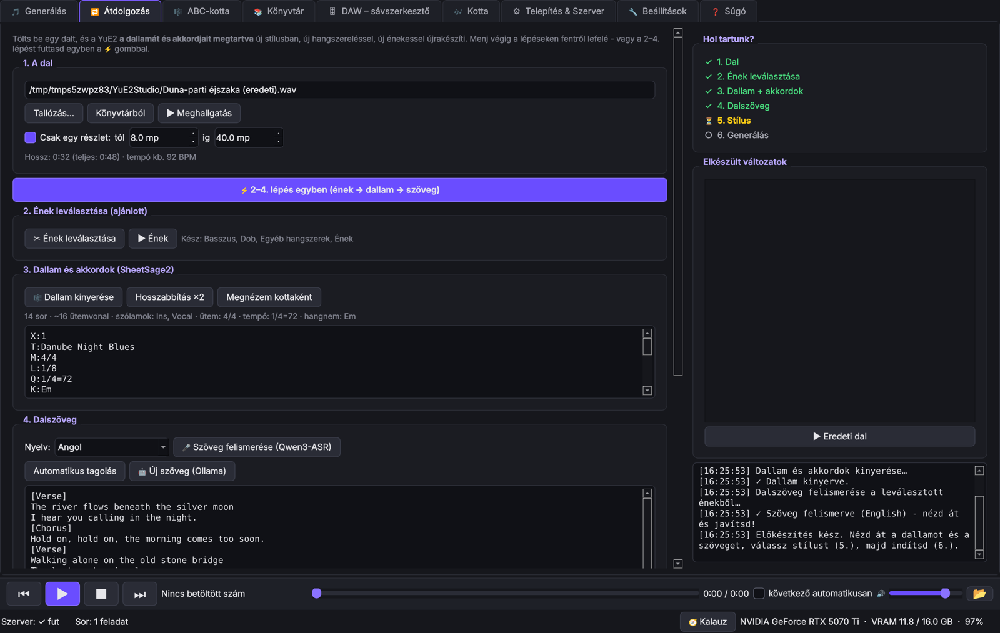
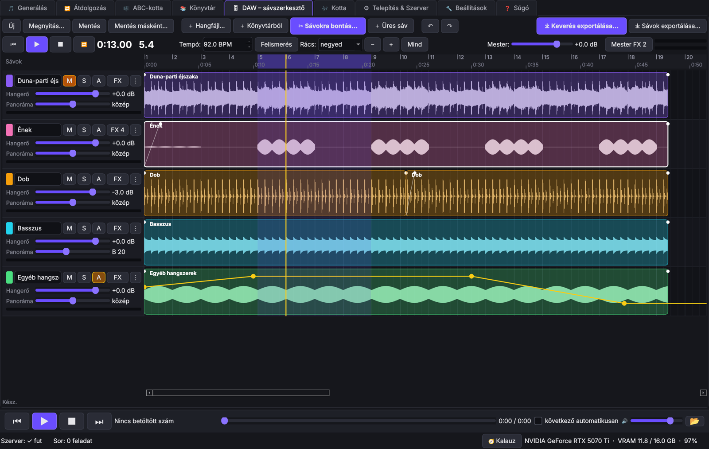
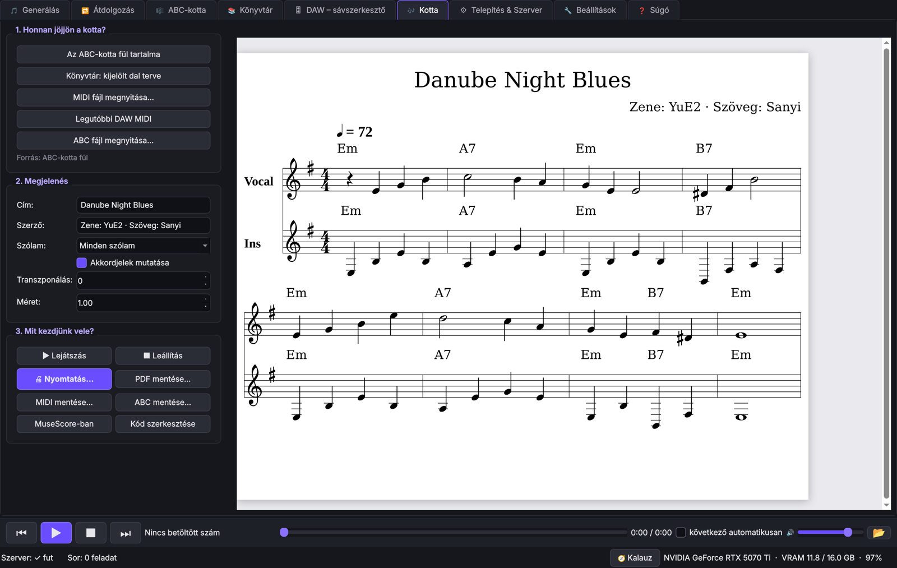
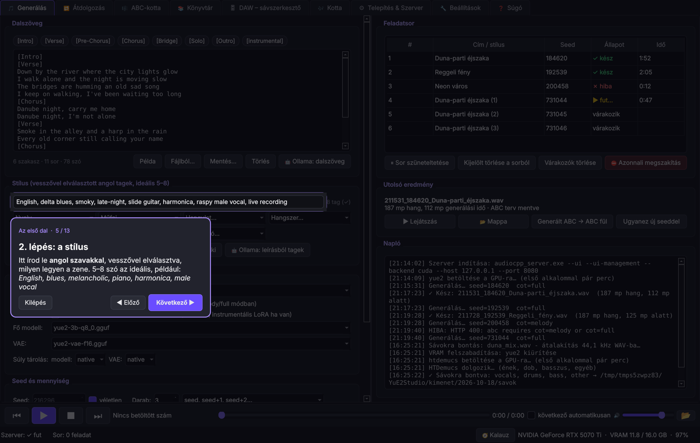

# YuE2 Studio

Magyar nyelvű asztali alkalmazás (Windows, PySide6) a **YuE2** zenegeneráló modellhez. A modell helyben, a saját
videókártyádon fut, az [audio.cpp](https://github.com/audio-cpp/audio.cpp) szerverén keresztül.



## Mit tud?

| Fül | Mire való |
|---|---|
| 🎵 **Generálás** | Dalszöveg + stílus → kész dal. Dal hossza csúszkával (15 mp – 6 perc), COT módok, seed, sorozatok, presetek, haladó paraméterek, LoRA-k, feladatsor |
| 🔁 **Átdolgozás** | Meglévő dal (MP3/WAV) új stílusban: ének leválasztása, dallam és akkordok kinyerése, dalszöveg-felismerés, generálás több stílusban egyszerre |
| 🎼 **ABC-kotta** | A dal zenei terve (dallam + akkordok): szerkesztés, hosszabbítás, kinyerés hangfájlból |
| 📚 **Könyvtár** | Minden generált szám: lejátszás, keresés, kedvencek, megjegyzés, MP3 export, beállítások visszatöltése |
| 🎛 **DAW** | Többsávos szerkesztő: sávokra bontás (ének, dob, basszus, egyéb), vágás, effektek, automáció, MIDI, export |
| 🎶 **Kotta** | Igazi kotta a tervből vagy MIDI-ből: transzponálás, lejátszás, nyomtatás, PDF |
| ⚙ **Telepítés & Szerver** | A motor és a modellek letöltése, a szerver indítása és naplója |

További szolgáltatások:
- Minden elemen **súgó buborék**.
- **Többnyelvű felület** (Beállítások → *Felület nyelve*): magyar, English, Deutsch, Français, Romani (lovári). A súgók, a Súgó fül és a Kalauz is lefordult. A fordítások a `lang/` mappában vannak, sima JSON fájlokban, bárki javíthatja őket. A romani fordítás gépi, ezért anyanyelvi átnézést kér. A PDF kézikönyv magyar.
- A **🧭 Kalauz** lépésenkénti bemutatókkal vezet végig a programon.
- **Projektek**: az összes fül tartalma egy fájlba menthető és visszatölthető. A Könyvtár csak az aktuális projekt dalait mutatja.
- **🧹 Tiszta lap** gomb minden munkafülön. Kilépéskor semmi sem vész el.
- Globális **lejátszósáv** az ablak alján.
- Helyi **Ollama** segéd a dalszöveg és a stílus-tagek írásához.

| Átdolgozás | DAW |
|---|---|
|  |  |
| **Kotta** | **Kalauz** |
|  |  |

## Telepítés és indítás

1. Telepítsd a **Python 3.10+** verziót (python.org, a „Add to PATH” legyen bepipálva).
2. Indítsd el a `YuE2_Studio_inditas.bat` fájlt. Az első indításkor feltelepíti a szükséges csomagokat
   (PySide6, numpy, pedalboard, sounddevice).
3. A **Telepítés & Szerver** fülön töltsd le a motort és a modelleket, majd indítsd el a szervert.

Kézi indítás:

```
pip install PySide6 numpy pedalboard sounddevice
python yue2_studio.py
```

Opcionális:
- **ffmpeg**: MP3 exporthoz.
- **Ollama**: szövegíró segédhez.
- **MuseScore**: a kotta további szerkesztéséhez.

## Gépigény

- NVIDIA videókártya CUDA-val. 16 GB VRAM ajánlott, a Q4 modellel kevesebb is elég.
- Ajánlott 32 GB+ RAM.
- Windows 10/11.

## Modellek

A program a következő modelleket tölti le, a `audio-cpp/audio.cpp-gguf` Hugging Face tárolóból:

| Modell | Mire jó |
|---|---|
| YuE2-3B (Q8 / Q4 / BF16) | zenegenerálás |
| SheetSage2 | dallam és akkordok kinyerése |
| HTDemucs | sávokra bontás |
| MuScriptor | hangból MIDI |
| Qwen3-ASR 1.7B | dalszöveg-felismerés |

## Kézikönyv

Részletes, képes, magyar nyelvű kézikönyv: [docs/YuE2_Studio_Kezikonyv.pdf](docs/YuE2_Studio_Kezikonyv.pdf)

## Licenc

**Mindent szabad – éljen a szoftverek szabadsága!** 🕊️

Az app kódja és a kézikönyv **közkincs** ([Unlicense](LICENSE)). Ez a létező legszabadabb licenc, semmit nem tilt:

- **Bárki, bármire** felhasználhatja: otthon, munkában, oktatásban, akár pénzért is.
- **Szabadon másolható, módosítható, továbbadható és eladható.**
- **Nem kell engedélyt kérni**, és még a szerző nevét sem kötelező feltüntetni.
  Az MIT licenc ezt megkövetelné, az Unlicense ezt sem kéri.

Egyetlen kikötése: **nincs garancia**. A program úgy van, ahogy van, és ha valami nem működik, senki nem vonható
felelősségre.

### A modellekre más szabályok vonatkoznak

Az app szabadsága nem terjed ki azokra a modellekre, amelyeket a program letölt és használ. Azok mások munkái,
a saját licencükkel:

- A **YuE2** modellsúlyok és a Mothersuperior LoRA-k licence **CC BY-NC 4.0**, vagyis csak nem kereskedelmi célra
  használhatók.
- Az audio.cpp licence MIT, a PySide6-é LGPL.
- Szerzői jogvédett dalt csak saját, nem nyilvános célra dolgozz át.
